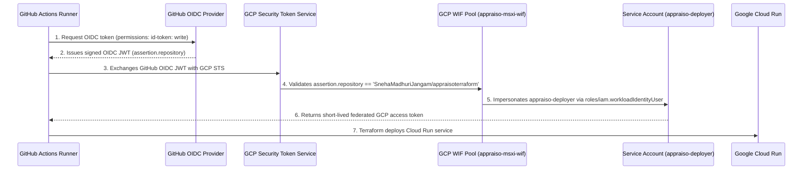

# Appraiso Demo: GCP Workload Identity Federation (WIF) & Cloud Run

This hands-on project demonstrates how to set up **Keyless Authentication (Workload Identity Federation)** between **GitHub Actions** and **Google Cloud Platform (GCP)** to deploy a Cloud Run service via **Terraform**.

---

## Architecture Overview



---

## Quickstart Guide

### 1. Authenticate Local GCP CLI
Run in your local terminal:
```powershell
gcloud auth login
gcloud auth application-default login
gcloud config set project newaiproject-510015
```

### 2. Run the Bootstrap Script
Run the PowerShell script from `d:\appraiso-demo`:
```powershell
powershell -ExecutionPolicy Bypass -File .\bootstrap\bootstrap-wif.ps1
```
*(Or use Git Bash / Cloud Shell: `bash bootstrap/bootstrap-wif.sh`)*

### 3. Add GitHub Variables
Go to your GitHub repository:
**`SnehaMadhuriJangam/appraisoterraform` -> Settings -> Secrets and variables -> Actions -> Variables**
Add the following 5 variables:
- `GCP_PROJECT_ID`: `newaiproject-510015`
- `GCP_REGION`: `us-central1`
- `GCP_WIF_PROVIDER`: `projects/<PROJECT_NUMBER>/locations/global/workloadIdentityPools/appraiso-msxi-wif/providers/github-oidc` *(printed by the script)*
- `GCP_SERVICE_ACCOUNT`: `appraiso-deployer@newaiproject-510015.iam.gserviceaccount.com`
- `TF_STATE_BUCKET`: `newaiproject-510015-tfstate`

### 4. Push Code to GitHub
```powershell
git init
git add .
git commit -m "feat: initial commit for WIF and Cloud Run with Terraform"
git branch -M main
git remote add origin https://github.com/SnehaMadhuriJangam/appraisoterraform.git
git push -u origin main
```

### 5. Run GitHub Actions
- Navigate to the **Actions** tab on GitHub.
- Run the **Cloud Run Deployment via WIF** workflow.
- Inspect the output to verify identity impersonation and grab the live Cloud Run URL!
